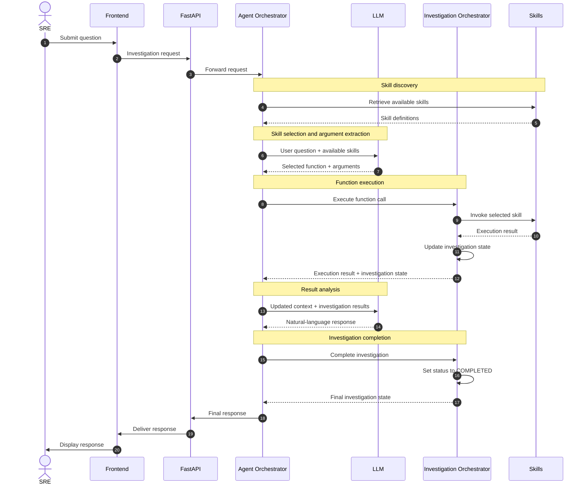

# SRE Agent – Request and Investigation Workflow

## Overview

The SRE Agent processes investigation requests submitted by Site Reliability Engineers (SREs). It uses an LLM-powered Agent Orchestrator to understand user questions, select appropriate skills, and coordinate their execution through the Investigation Orchestrator.

The architecture separates decision-making, function execution, and investigation lifecycle management into distinct components.

## Architecture Components

| Component | Responsibility |
|---|---|
| **Frontend** | Provides the interface through which SREs submit investigation requests and view results. |
| **FastAPI** | Receives requests from the frontend and forwards them to the Agent Orchestrator. |
| **Agent Orchestrator** | Coordinates interactions between the LLM and Investigation Orchestrator. Retrieves available skills and manages agent context. |
| **LLM** | Analyses user questions, selects appropriate skills, extracts function arguments, and generates natural-language responses. |
| **Investigation Orchestrator** | Executes requested functions, manages investigation state, and tracks the investigation lifecycle. |
| **Skills** | Provide individual functions and capabilities used to investigate infrastructure and application issues. |

---

## Request and Investigation Workflow

The following sequence diagram illustrates how an investigation request travels through the system, from the initial user question to the final response.



---

## Workflow Description

### 1. User Submits a Question

The SRE submits an investigation request through the frontend.

### 2. FastAPI Forwards the Request

FastAPI receives the request and forwards it to the Agent Orchestrator.

### 3. Agent Orchestrator Retrieves Available Skills

The Agent Orchestrator retrieves the available skills, including their descriptions, function definitions, and required parameters.

It provides these definitions, together with the user's question, to the LLM.

### 4. LLM Selects a Skill and Extracts Arguments

The LLM analyses the user's question, identifies the appropriate skill, extracts the required arguments, and determines which function needs to be executed.

### 5. LLM Returns a Function Call

The LLM returns a structured function call containing the selected function and its arguments to the Agent Orchestrator.

**Example:**

```python
check_cpu(server="server1")
```

### 6. Agent Orchestrator Forwards the Function Call

The Agent Orchestrator forwards the selected function and its arguments to the Investigation Orchestrator.

### 7. Investigation Orchestrator Executes the Function

The Investigation Orchestrator:

- Invokes the requested skill function.
- Awaits its execution.
- Retrieves the execution result.
- Updates and saves the investigation state.
- Returns the execution result and investigation state to the Agent Orchestrator.

### 8. Agent Orchestrator Updates the Context

The Agent Orchestrator incorporates the returned results into its context and sends the updated context to the LLM.

### 9. LLM Generates the Response

The LLM analyses the investigation results and generates a natural-language response based on the available information.

It returns the response to the Agent Orchestrator.

### 10. Investigation Is Marked as Completed

Once all required investigation functions have finished executing and the investigation has reached its completion criteria, the Investigation Orchestrator updates the investigation status to `COMPLETED`.

### 11. Response Is Delivered to the Frontend

The Agent Orchestrator returns the final response to FastAPI.

FastAPI forwards it to the frontend, where it is displayed to the SRE.

---

## Investigation Execution Loop

An investigation is not necessarily limited to a single function call.

Depending on the user's question and the results returned by individual skills, the LLM may need to request multiple function executions before producing a final response.

**Example: Investigating a Server Performance Issue**

1. Check CPU utilization.
2. Check memory utilization.
3. Retrieve application logs.
4. Check service health.
5. Analyse and correlate the results.
6. Generate a final investigation report.

The Agent Orchestrator coordinates this iterative interaction between the LLM and Investigation Orchestrator until sufficient information is available to produce a final response.

---

## Investigation State Management

The system maintains investigation state throughout the execution lifecycle.

The responsibilities are separated as follows:

- **Investigation Orchestrator:** Owns the investigation execution state, function results, and lifecycle status.
- **Agent Orchestrator:** Maintains the agent context and incorporates investigation results into subsequent LLM interactions.

This separation ensures that investigation execution and LLM reasoning remain independent while allowing them to work together.

### Investigation Lifecycle

| Status | Description |
|---|---|
| `PENDING` | Investigation request has been received but execution has not started. |
| `RUNNING` | Investigation is currently executing. |
| `COMPLETED` | Investigation has successfully finished. |
| `FAILED` | Investigation execution has failed. |

---

## Summary

The SRE Agent architecture provides a modular approach to automated infrastructure investigations.

By separating the responsibilities of the Agent Orchestrator, LLM, and Investigation Orchestrator, the system enables:

- **Dynamic skill selection:** The LLM selects appropriate skills based on the user's question.
- **Automated execution:** The Investigation Orchestrator executes the selected functions.
- **Iterative investigations:** Multiple skills can be executed to gather and correlate information.
- **State management:** Investigation progress and execution results are tracked throughout the lifecycle.
- **Natural-language responses:** The LLM converts investigation results into understandable responses for SREs.

## Project Structure

```

sre-agent/                              # Root directory of the SRE Agent project
│
├── README.md                           # Project documentation, architecture, setup and usage instructions
├── pyproject.toml                      # Project metadata, dependencies, build configuration and development tools
├── .env.example                        # Example environment variables required to configure the application
├── .gitignore                          # Files and directories Git should exclude from version control
│
├── app/                                # Main application source code
│   ├── __init__.py                     # Marks app as a Python package
│   ├── main.py                         # FastAPI application entry point; initializes the application and registers routes
│   ├── dependencies.py                 # Creates and provides shared application components through dependency injection
│   │
│   ├── api/                            # HTTP API layer; handles communication with the frontend
│   │   ├── __init__.py                 # Marks api as a Python package
│   │   ├── routes/                     # API endpoint definitions
│   │   │   ├── __init__.py             # Marks routes as a Python package
│   │   │   └── investigations.py       # Handles investigation requests and returns investigation results
│   │   └── schemas/                    # Pydantic request and response models
│   │       ├── __init__.py             # Marks schemas as a Python package
│   │       └── investigation.py        # Defines investigation request and response structures
│   │
│   ├── core/                           # Shared application configuration and infrastructure
│   │   ├── __init__.py                 # Marks core as a Python package
│   │   ├── config.py                   # Loads and validates application configuration and environment variables
│   │   └── logging.py                  # Configures application logging and log formats
│   │
│   ├── orchestrators/                  # Coordinates agent reasoning and investigation execution
│   │   ├── __init__.py                 # Marks orchestrators as a Python package
│   │   ├── agent_orchestrator.py       # Coordinates LLM interactions, skill selection, tool calls and agent context
│   │   └── investigation_orchestrator.py # Executes selected skills and manages the investigation execution lifecycle
│   │
│   ├── agent/                          # LLM integration and agent-specific logic
│   │   ├── __init__.py                 # Marks agent as a Python package
│   │   ├── llm_client.py               # Handles communication with the LLM provider
│   │   ├── skill_selector.py           # Selects appropriate skills and extracts function arguments using LLM output
│   │   └── prompts/                    # Stores prompts used to guide LLM behaviour
│   │       └── system_prompt.txt       # Defines the LLM's role, instructions and investigation behaviour
│   │
│   ├── skills/                         # Collection of executable investigation capabilities
│   │   ├── __init__.py                 # Marks skills as a Python package
│   │   ├── registry.py                 # Registers available skills and makes them discoverable by the agent
│   │   ├── base.py                     # Defines the common interface and contract that every skill must implement
│   │   └── infrastructure/            # Infrastructure monitoring and investigation skills
│   │       ├── __init__.py             # Marks infrastructure as a Python package
│   │       ├── cpu.py                  # Checks CPU utilization and related CPU metrics
│   │       ├── memory.py               # Checks memory utilization and memory-related metrics
│   │       ├── disk.py                 # Checks disk utilization, capacity and storage metrics
│   │       └── health.py               # Checks server, application and service health
│   │
│   ├── investigations/                 # Investigation data models, persistence and state management
│   │   ├── __init__.py                 # Marks investigations as a Python package
│   │   ├── models.py                   # Defines investigation models, statuses and data structures
│   │   ├── state_manager.py            # Creates investigations and manages their state transitions and results
│   │   └── repository.py               # Provides the data access layer for storing and retrieving investigations
│   │
│   └── services/                       # Reusable application-level business services
│       ├── __init__.py                 # Marks services as a Python package
│       └── response_service.py         # Formats investigation results into structured responses for the frontend
│
├── tests/                              # Automated test suite
│   ├── __init__.py                     # Marks tests as a Python package
│   ├── test_api.py                     # Tests FastAPI endpoints, request validation and API responses
│   ├── test_agent_orchestrator.py      # Tests agent coordination, LLM interactions and skill selection
│   ├── test_investigation_orchestrator.py # Tests skill execution, result handling and investigation lifecycle
│   └── skills/                         # Unit tests for individual investigation skills
│       ├── test_cpu.py                 # Tests CPU investigation skill behaviour
│       └── test_memory.py              # Tests memory investigation skill behaviour
│
└── scripts/                            # Utility scripts for development and execution
    └── run.py                          # Provides an alternative entry point for starting the application
```

